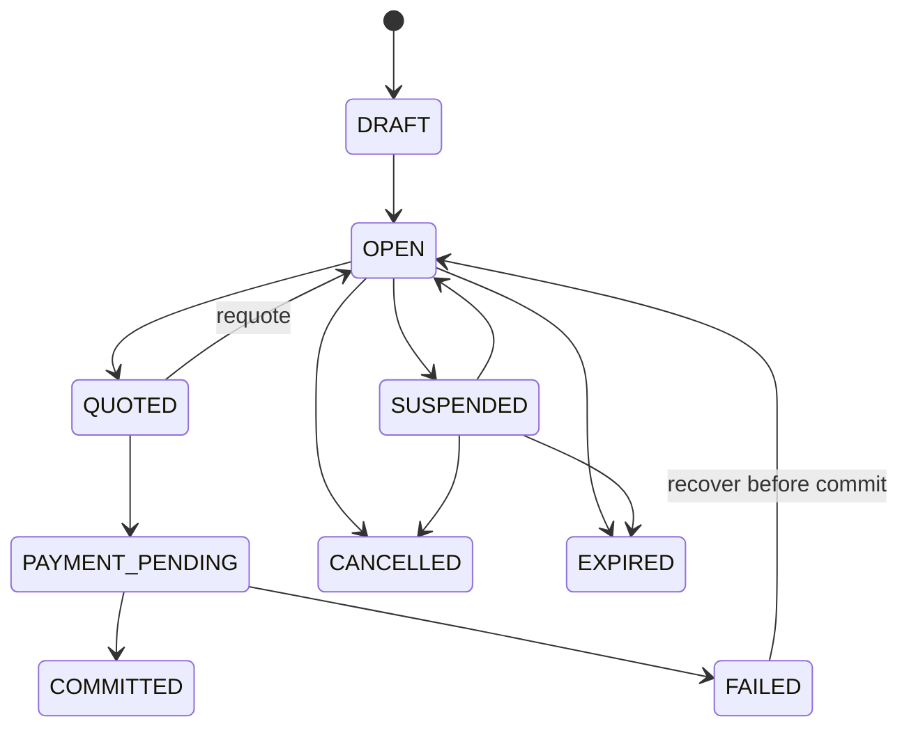
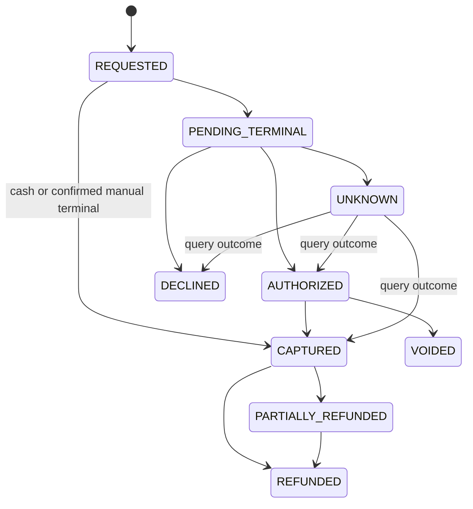
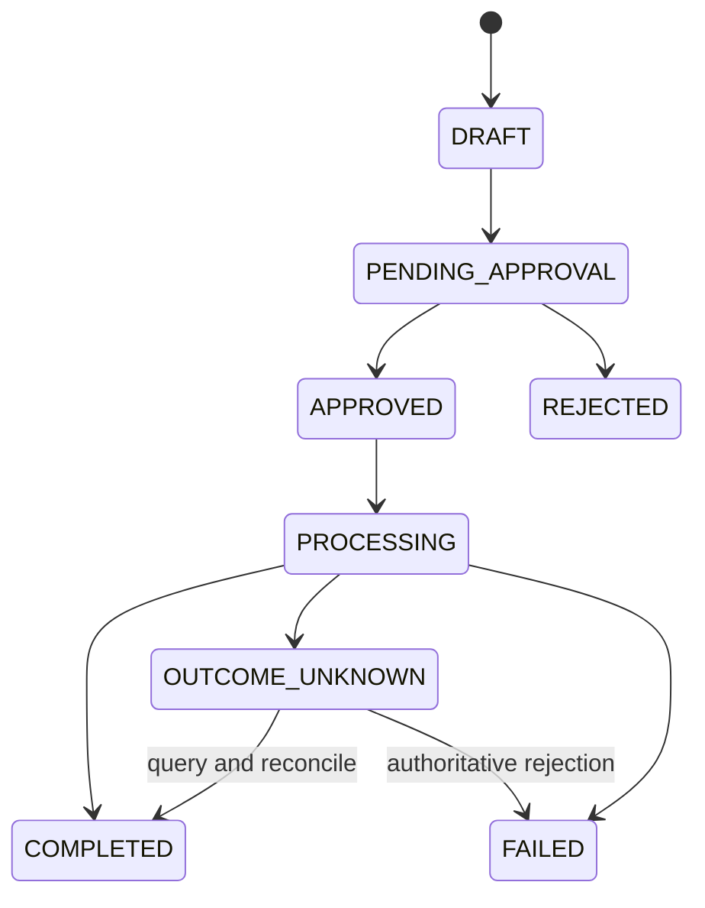
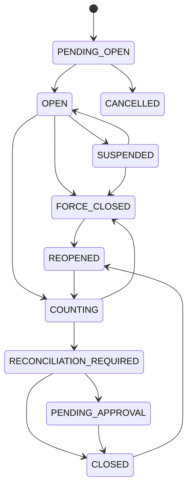
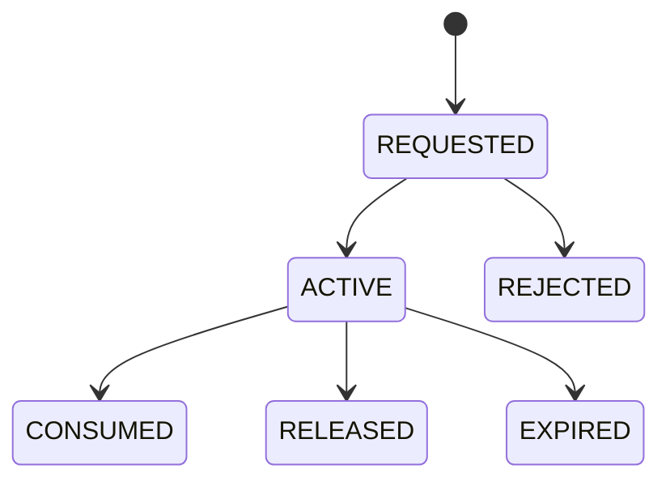
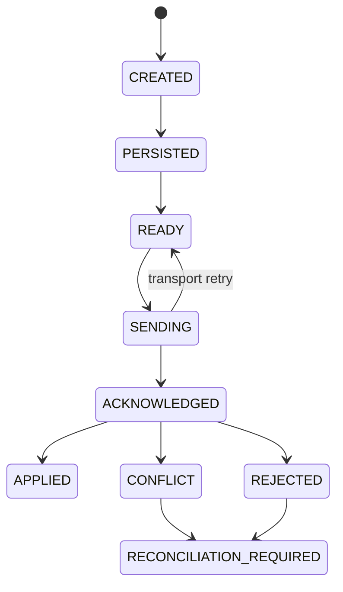
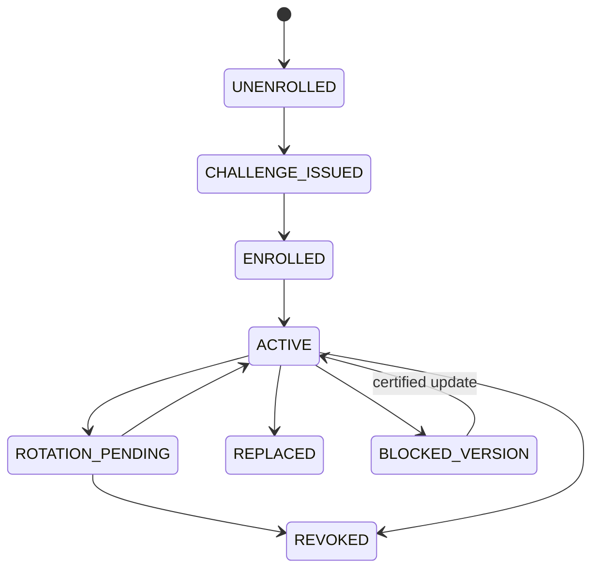
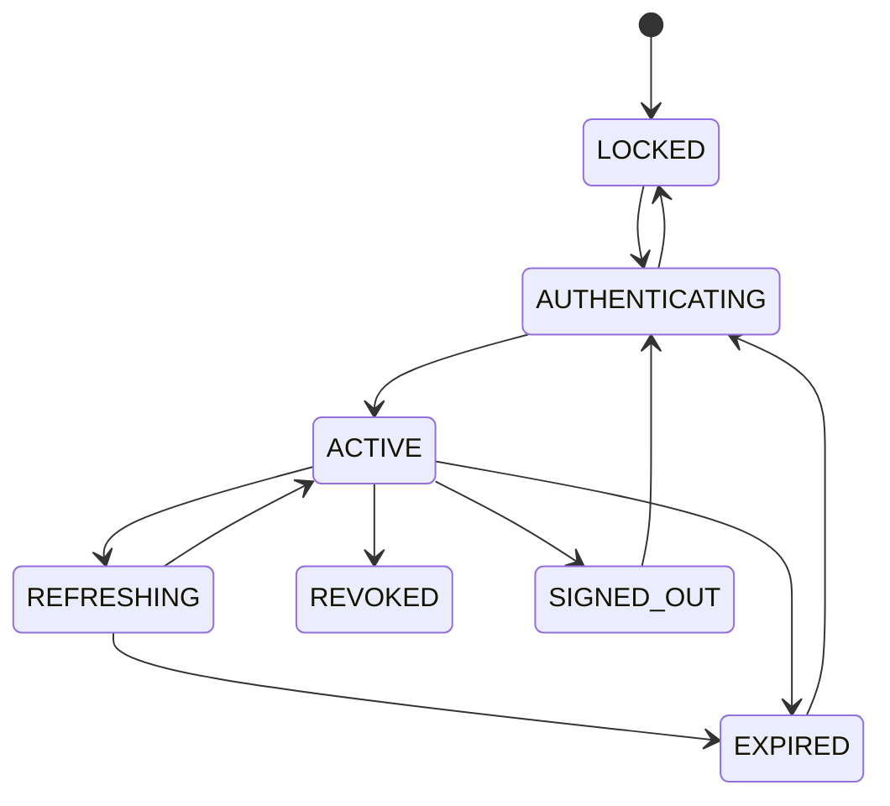
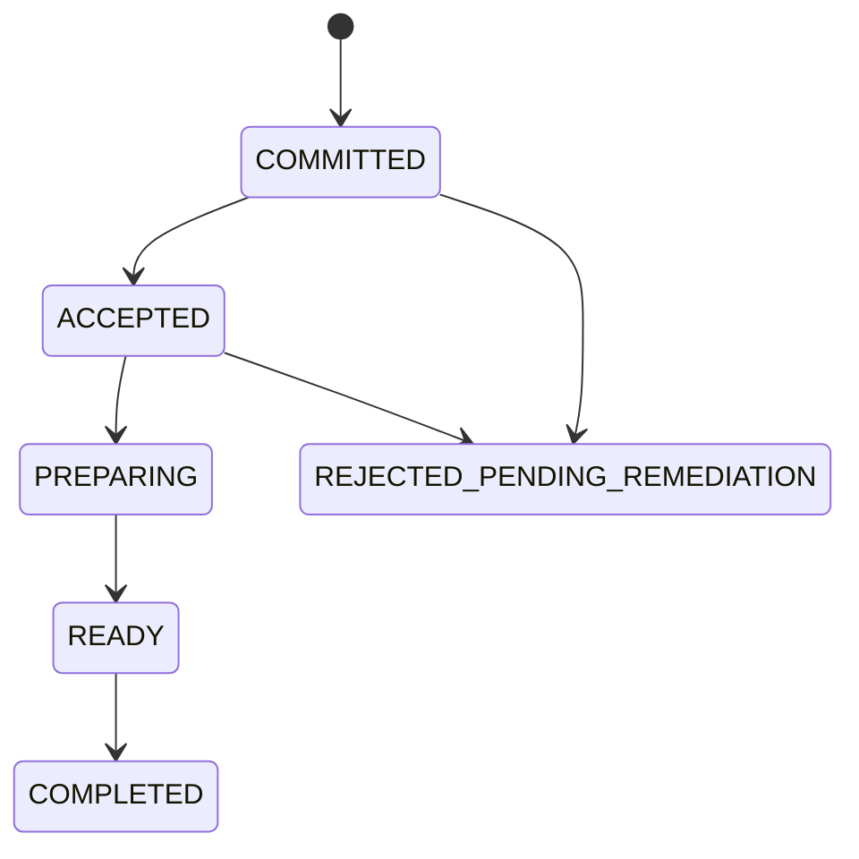
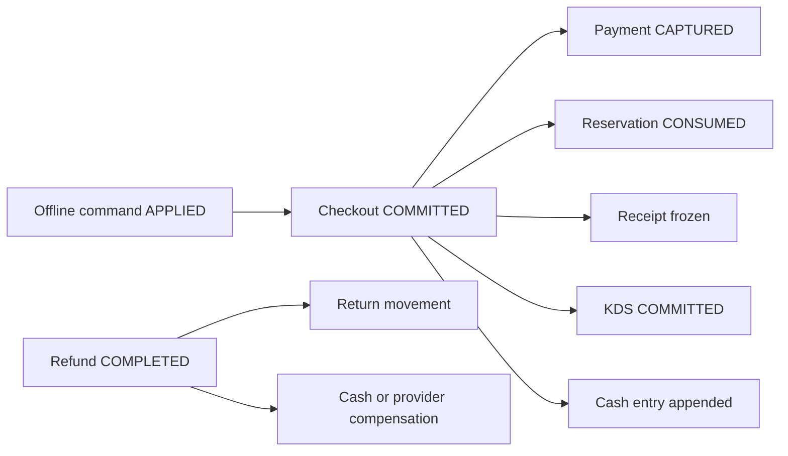

# Phase 0B — Business State Machines

## Reading contract

These state machines define behavior for future UMI implementation. State names are conceptual
unless already fixed by `packages/contract` in a later phase. Full transition metadata, rollback,
recovery, timeout behavior, and invariant checks live in `phase-0b-state-machines.json`.

## Checkout and sale

Commit is the irreversibility boundary. Before it, cancellation releases reservations and loyalty
authorization. After it, only refunds or compensating facts correct history.

## Payment intent

`UNKNOWN` permits query and reconciliation only. It never transitions to a new `REQUESTED` charge.

## Refund

The approved command fingerprint, refundable remainder, original allocations, and inventory
destination are fixed before processing.

## Physical cash shift

Normal close requires zero pending device commands, a count, reconciliation, and any required
approval. Force-close and reopen append exceptional evidence and never rewrite the ledger.

## Inventory reservation

Consumption, release, and expiry are terminal. A later correction is a new inventory movement.

## Offline command

Persistence precedes tender or network interaction. Conflicts are visible; no command is silently
deleted, repriced, reordered, or retried under a new identity.

## Device enrollment and trust

Revoked and replaced devices cannot reactivate. Recovery issues a new bounded challenge or rotates
to new non-exportable key material; shared secrets are never redisclosed.

## Operator session

Refresh during an active shift still needs device proof and current membership, branch, and
entitlement. Revocation fails the next online command closed.

## Kitchen order

Only committed orders enter KDS. Offline kitchen rejection creates a manager-remediation task; it
does not alter payment, cash, loyalty, or inventory.

## Cross-machine ordering

For cash checkout these effects are one authoritative commit. Asynchronous delivery may project or
notify, but must not infer a missing core financial effect.
